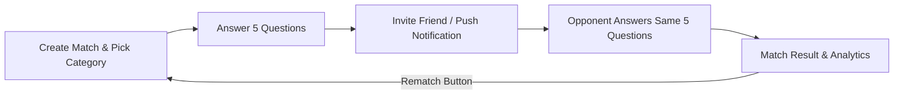

# SKOR! — 1v1 Sports Trivia Mobile App Showcase ⚽🏀📱

**English** | [Türkçe](README.tr.md)

**An asynchronous turn-based 1v1 sports trivia mobile app where players challenge friends in football and basketball knowledge.**

Engineered with Flutter and Firebase to solve the superficiality of generic trivia apps by delivering deep, localized, and competitive sports trivia tailored for sports fans.

> ℹ️ **About This Showcase:**  
> This repository is a **product showcase and mobile architecture portfolio**. The complete application source code (Flutter / Dart widgets, Firebase security rules, and question generation pipelines) is maintained in a private repository. This repository highlights the core game loop, architecture principles, global benchmark analysis, and product roadmaps.

---

## 🎮 Core Game Loop

* **Asynchronous Matchmaking:** Players do not need to be online concurrently. One user plays their round, a push notification alerts the friend, and the friend responds on their own schedule.
* **Pitch Progress Telestration:** Each correct answer advances the ball along a virtual pitch toward the goal/basket; incorrect answers trigger turnovers.
* **Rematch Loop:** Streamlined rematch triggers closing the retention loop.

---

## 🏗️ System & Data Architecture

* **Flutter & Dart:** Single cross-platform codebase compiling to native 60 FPS performance on iOS and Android.
* **Firebase Cloud Firestore:** Low-latency real-time database protected by strict Firestore Security Rules preventing client-side inspection of answer keys or in-progress match scores.
* **Daily Challenge:** Global synchronized challenge set resetting daily with leaderboard rankings.
* **Curated Content Generation:** Verified questions categorized across leagues (Premier League, La Liga, Super Lig, NBA, EuroLeague, World Cup history).

---

## 💻 Tech Stack

| Layer | Technology |
|---|---|
| **Mobile Client** | Flutter, Dart (iOS & Android) |
| **State Management** | Provider / Riverpod state architecture |
| **Cloud & Backend** | Firebase Cloud Firestore, Firebase Auth, Firebase Cloud Messaging (FCM) |
| **Testing & QA** | Flutter Driver, Unit & Widget test suites (game flows, rematch logic) |
| **Specifications** | [docs/PLAN.md](docs/PLAN.md) · [docs/GLOBAL_BENCHMARK.md](docs/GLOBAL_BENCHMARK.md) |

---

## 🔒 Confidentiality Notice
Proprietary mobile code, Firebase API keys, and administrative credentials remain private.
