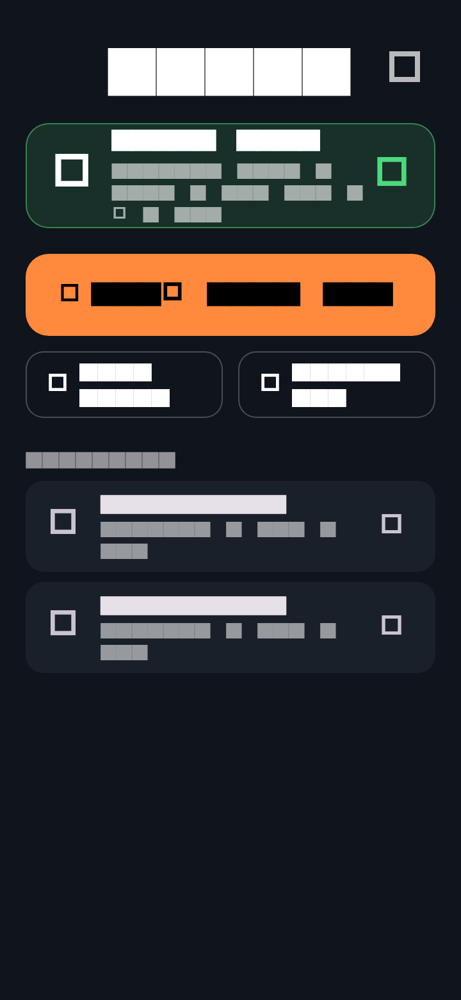
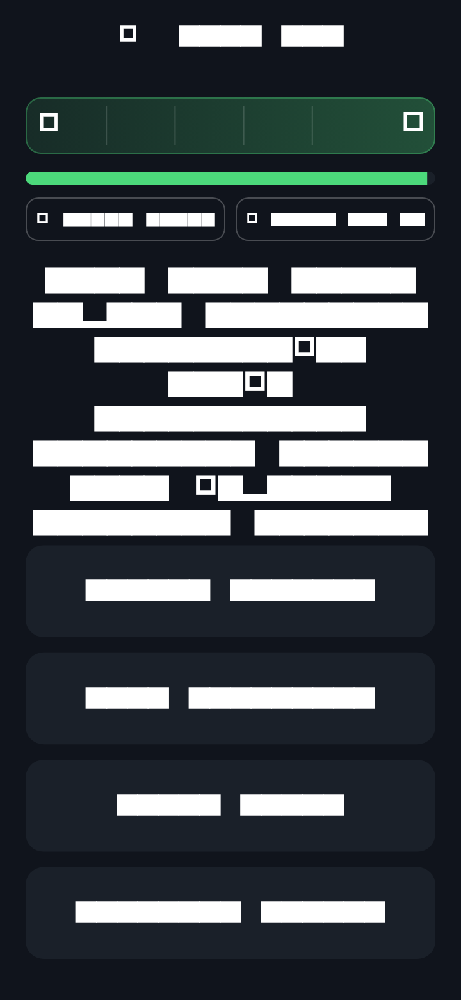
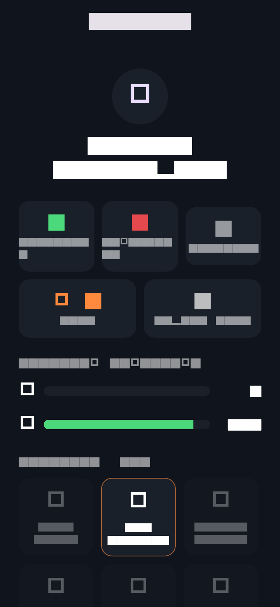
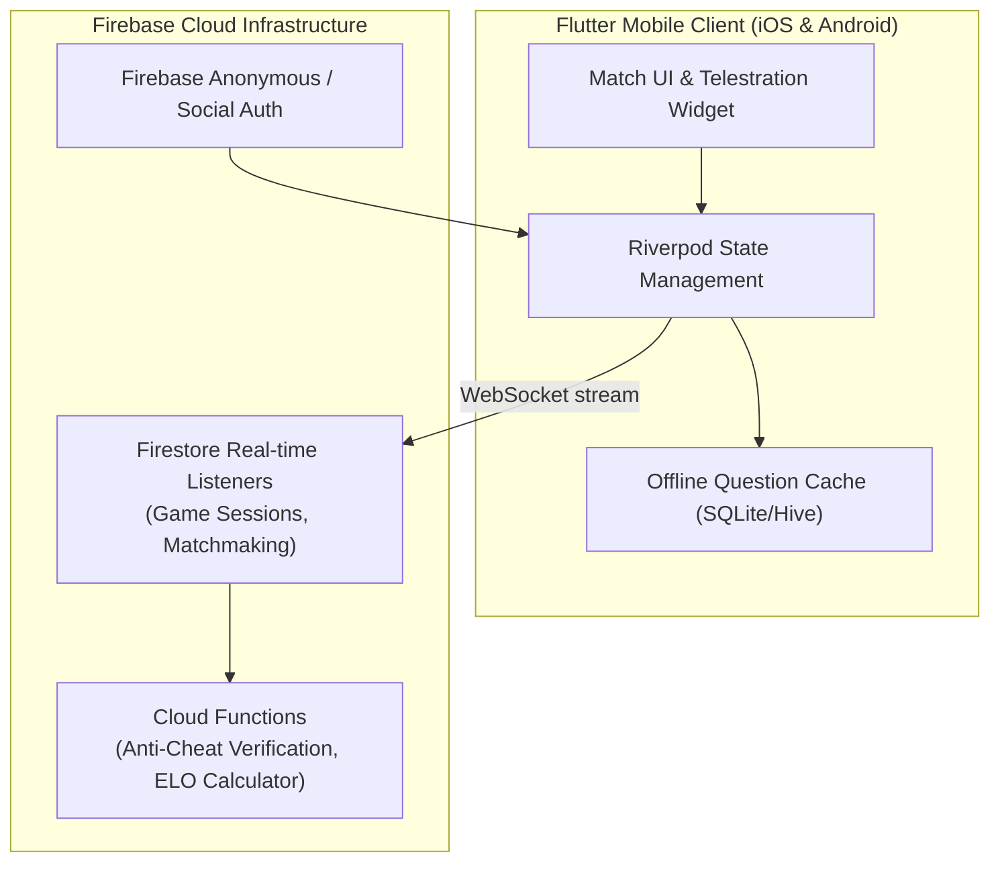

# SKOR! — 1v1 Sports Trivia Mobile App — Showcase ⚽📱🏀

**English** | [Türkçe](README.tr.md)

**A real-time, turn-based 1v1 sports trivia mobile game built with Flutter & Dart, backed by Firebase Firestore, Cloud Functions, and an interactive football pitch progress telestration loop.**

> 🔒 **About This Showcase:**  
> This repository is a **product showcase and architecture portfolio**. The full Flutter mobile client source code and Firebase Cloud Functions backend are maintained in a private repository. This repository highlights the gameplay loop, telestration widget design, Firestore synchronization, and UI screens.

---

## 📱 Mobile App Screens & Gameplay Tour

<p align="center">
  
</p>

| 1. Home Dashboard | 2. Live 1v1 Match | 3. Match Recap Card | 4. Profile & Trophy Room |
|:---:|:---:|:---:|:---:|
|  |  |  |  |
| *Daily challenge, game creation & match history* | *Turn-based 1v1 football trivia with countdown timer* | *High-fidelity shareable match victory card* | *Player stats, achievements & trophy collection* |

---

## 🎮 Game Loop & Pitch Progress Mechanics

Unlike generic trivia apps that simply count points, **SKOR!** simulates a live football attack:

```
[Defensive Half] ──> [Midfield] ──> [Final Third] ──> [Penalty Box] ──> [⚽ GOAL!]
      (Step 1)          (Step 2)          (Step 3)           (Step 4)        (Step 5)
```

- Each attack turn gives the active player **5 timed questions**.
- **Correct Answer:** The ball advances one step forward across the tactical pitch markings.
- **5 out of 5:** The player scores a **GOAL (1-0)**!
- **Wrong Answer:** The opponent's defense intercepts the ball; the step is lost.
- **Jokers:** **50:50 Pass** (removes 2 incorrect choices) and **VAR Review** (second chance on a contested call).
- Matches consist of **3 attacking rounds per player** with sudden-death penalties on a tie.

---

## 🏗️ Architecture Topology



---

## 🛠 Tech Stack

| Layer | Technology |
|---|---|
| **Mobile Framework** | Flutter 3.x, Dart 3.x (iOS & Android) |
| **State Management** | Flutter Riverpod |
| **Backend & Sync** | Firebase Firestore (real-time document streams), Cloud Functions |
| **Auth & Security** | Firebase Auth, Server-side question answer validation |
| **UI & Audio** | Custom pitch canvas painter, Haptic feedback, dark match-night palette |
| **Specifications** | [docs/OYUN-MEKANIGI.md](docs/OYUN-MEKANIGI.md) · [docs/FIRESTORE-SEMA.md](docs/FIRESTORE-SEMA.md) |

---

## 🔒 Confidentiality Notice
Proprietary Flutter client code, question banking database, and Firebase backend rules remain private.
