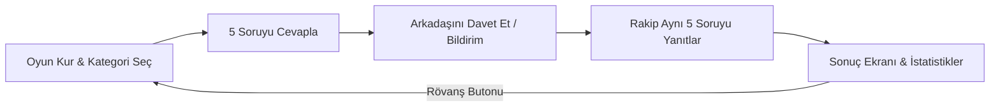

# SKOR! — 1v1 Spor Bilgi Yarışması Mobil Uygulama Vitrini ⚽🏀📱

[English](README.md) | **Türkçe**

**Arkadaşlarla futbol ve basketbol bilgisini kapıştıran, sıra tabanlı (asenkron) 1v1 mobil bilgi yarışması.**

Genel trivia uygulamalarının spordaki yüzeyselliğini aşarak; güncel, derinlikli ve rekabetçi spor tartışmalarını mobil bir oyun deneyimine dönüştüren Flutter ve Firebase mimarisi.

> ℹ️ **Bu Vitrin Hakkında:**  
> Bu depo **ürün tanıtımı ve mobil mimari portföyü** içindir. Uygulama kaynak kodları (Flutter / Dart widget'ları, Firebase güvenlik kuralları ve backend içerik üretim betikleri) ayrı bir **private** depoda tutulmaktadır. Bu depoda oyun tasarımı (core loop), mimari prensipler, küresel kıyaslama analizleri ve ürün yol haritası yayımlanmaktadır.

---

## 🎮 Temel Oyun Döngüsü (Core Loop)

* **Asenkron Rekabet:** Her iki oyuncunun aynı anda çevrimiçi olmasına gerek yoktur. Bir oyuncu turunu tamamlar, rakibe anlık bildirim gider ve rakip gün içinde kendi turunu oynar.
* **Saha İlerleme Göstergesi (Pitch Progress):** Her doğru cevapta top sanal sahada rakip kaleye/potaya doğru ilerler; yanlış cevapta top kaybı yaşanır.
* **Rövanş Mekaniği:** Maç bitiminde doğrudan rövanş teklifiyle oyuncu bağlılığı (retention) maksimize edilir.

---

## 🏗️ Sistem ve Veri Mimarisi

* **Flutter & Dart:** Tek kod tabanı ile hem iOS hem Android platformlarında akıcı ve yerel (native) 60 FPS performans.
* **Firebase Cloud Firestore:** Düşük gecikmeli gerçek zamanlı veritabanı. Güvenlik kuralları (Firestore Security Rules) ile oyuncuların cevap anahtarlarına veya tamamlanmamış oyun skorlarına hileli erişimi engellenir.
* **Günlük Mücadele (Daily Challenge):** Her gün yenilenen ortak soru seti ile küresel liderlik tablosu (leaderboard).
* **Akıllı Soru Havuzu Üretimi:** Kategori bazlı (Süper Lig, Premier League, NBA, EuroLeague, Dünya Kupası tarihi) doğrulanmış soru mimarisi.

---

## 💻 Kullanılan Teknolojiler

| Katman | Teknoloji |
|---|---|
| **Mobil İstemci** | Flutter, Dart (iOS & Android) |
| **Durum Yönetimi** | Provider / Riverpod desenleri |
| **Backend & Veritabanı**| Firebase Cloud Firestore, Firebase Auth, Cloud Messaging (FCM) |
| **Test & Kalite** | Flutter Driver, Unit & Widget testleri (oyun akışları, rövanş mantığı) |
| **Planlama & Analiz** | [docs/PLAN.md](docs/PLAN.md) · [docs/GLOBAL_BENCHMARK.md](docs/GLOBAL_BENCHMARK.md) |

---

## 🔒 Güvenlik ve Gizlilik Bildirimi
Uygulama kaynak kodları, Firebase API anahtarları ve veritabanı servis hesapları gizli tutulmaktadır.
