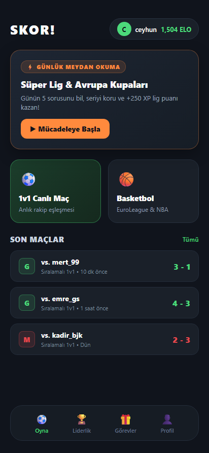
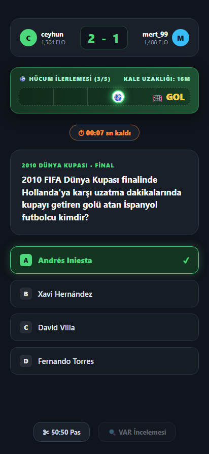
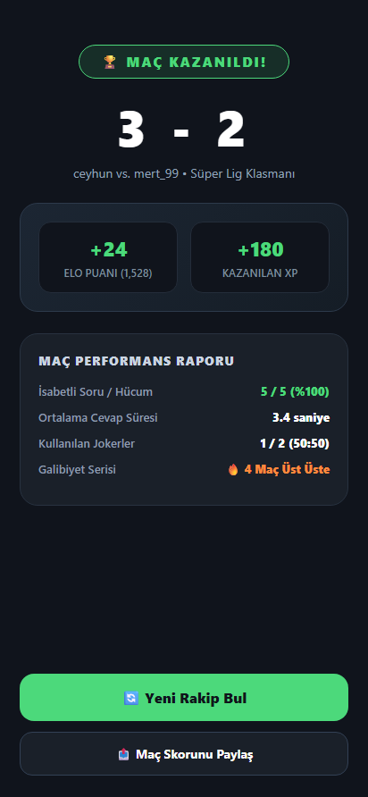
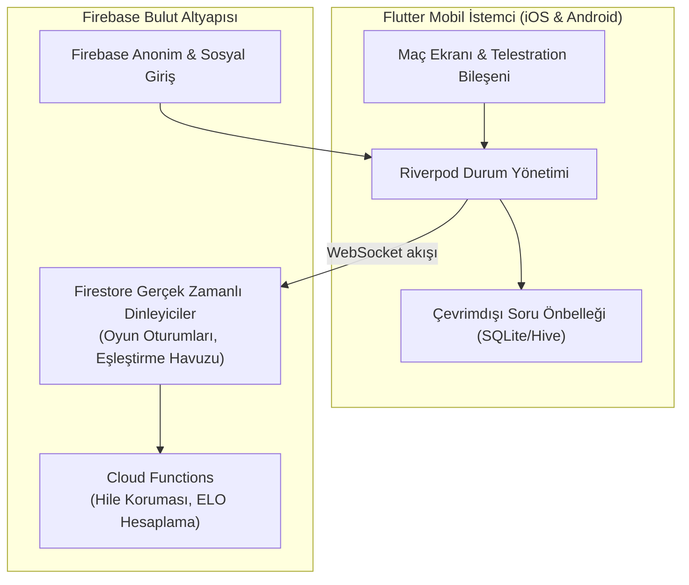

# SKOR! — 1v1 Mobil Spor Bilgi Yarışması — Vitrin ⚽📱🏀

[English](README.md) | **Türkçe**

**Flutter & Dart ile geliştirilmiş, Firebase Firestore ve Cloud Functions ile desteklenen, saha içi telestration pas animasyonlarına sahip gerçek zamanlı 1v1 sıra tabanlı spor bilgi yarışması oyunu.**

> 🔒 **Bu Vitrin Hakkında:**  
> Bu depo teknik bir **ürün vitrini ve mimari portföyüdür**. Flutter mobil istemci kaynak kodları ve Firebase altyapısı özel bir depoda korunmaktadır. Bu vitrin oyun döngüsünü, saha ilerleme mekaniğini, Firestore veri akışını ve ekran görüntülerini belgeler.

---

## 📱 Mobil Uygulama Ekran Görüntüleri

<p align="center">
  
</p>

| 1. Ana Ekran Paneli | 2. Canlı 1v1 Maç & Saha İlerlemesi | 3. Maç Sonu & Galibiyet |
|:---:|:---:|:---:|
|  |  |  |
| *Oyuncu seviyesi, ELO puanı ve Günlük Görev kartı* | *Pitch Progress ile paslaşarak kaleye ilerleme tele-çizgisi* | *3 - 2 Maç skoru, +24 ELO artışı ve maç performans raporu* |

---

## 🎮 Oyun Döngüsü ve Saha İlerleme (Pitch Progress) Mekaniği

Klasik soru-cevap uygulamalarından farklı olarak **SKOR!**, her soru serisini bir futbol hücumuna dönüştürür:

```
[Savunma Sahası] ──> [Orta Saha] ──> [3. Bölge] ──> [Ceza Sahası] ──> [⚽ GOL!]
     (1. Adım)           (2. Adım)         (3. Adım)         (4. Adım)         (5. Adım)
```

- Sırası gelen oyuncuya hücum başına **5 süreli soru** yöneltilir.
- **Doğru Cevap:** Top, taktik saha çizgileri üzerinde kaleye doğru 1 adım ilerler.
- **5'te 5 Başarı:** Hücum **GOL (1-0)** ile sonuçlanır!
- **Yanlış Cevap:** Rakip savunma araya girer; hücum adımı kaybedilir.
- **Jokerler:** **50:50 Pas** (2 yanlış şıkkı eler) ve **VAR İncelemesi** (hatalı yanıtta ikinci şans tanır).
- Maçlar her iki oyuncu için **3'er hücum devresi** sürer; beraberlikte seri penaltı atışlarına geçilir.

---

## 🏗️ Mimari Topoloji



---

## 🛠 Teknoloji Yığını

| Katman | Teknoloji |
|---|---|
| **Mobil Çatı** | Flutter 3.x, Dart 3.x (iOS & Android) |
| **Durum Yönetimi** | Flutter Riverpod |
| **Backend & Senkronizasyon** | Firebase Firestore (gerçek zamanlı belge akışları), Cloud Functions |
| **Kimlik & Güvenlik** | Firebase Auth, Sunucu taraflı şifrelenmiş cevap doğrulama |
| **Görsel & Ses** | Özel tuval (CustomPainter) saha çizimi, Haptic titreşim, karanlık maç teması |
| **Detaylı Belgeler** | [docs/OYUN-MEKANIGI.md](docs/OYUN-MEKANIGI.md) · [docs/FIRESTORE-SEMA.md](docs/FIRESTORE-SEMA.md) |

---

## 🔒 Gizlilik Bildirimi
Telif hakkı içeren Flutter kaynak kodları, soru bankası veri tabanı ve Firebase kuralları gizli tutulmaktadır.
